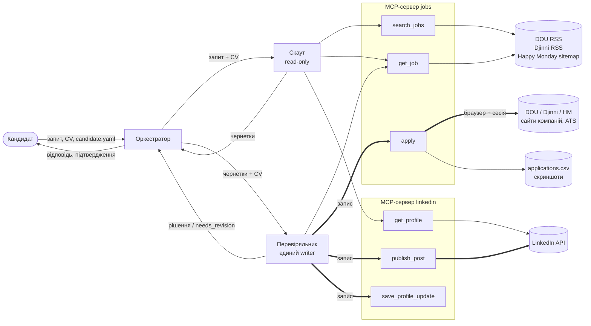

# Jobs Helper MCP — етапи та архітектура

Короткий огляд проєкту. Детальний план з критеріями готовності — у `PLAN.md`.

## Етапи

| # | Етап | Результат |
|---|---|---|
| 0 | Середовище | uv-проєкт, залежності, Playwright Chromium, `.gitignore` для сесій і секретів |
| 1 | Розвідка | `docs/recon.md`: поля даних DOU / Djinni / Happy Monday, форми відгуку, статистика зовнішніх ATS, поля `candidate.yaml`, робочий LinkedIn-токен |
| 2 | Джерела даних | адаптери DOU (RSS), Djinni (RSS), Happy Monday (sitemap + HTML), спільна модель `Job`, кеш, знімки вакансій |
| 3 | MCP-сервер `jobs` | `search_jobs`, `get_job`, `apply` (бекенд `mock`), трекер заявок, коди помилок, аудит-лог, перевірка через MCP-клієнт |
| 4 | Відгук через браузер | бекенд `browser` для `apply`: Djinni → DOU → Happy Monday → зовнішні ATS; політика відправки для кожного сайту (`manual` / `confirm` / `auto`) + глобальний `--dry-run`; `needs_input` для невідомих полів |
| 5 | MCP-сервер `linkedin` | OAuth-логін, `get_profile`, `publish_post` (Posts API), `save_profile_update` |
| 6 | Рантайм агентів | запуск агента з обмеженим набором інструментів (Claude Agent SDK), трейсинг у JSONL і консоль |
| 7 | Два агенти | Скаут (читає, готує чернетки) + Перевіряльник (єдиний, хто пише), оркестрація з одним раундом доопрацювання |
| 8 | Один агент | базовий варіант з усіма інструментами для порівняння |
| 9 | Оцінка | 5 тестових запитів на знімку + mock, порівняння multi та single, `RESULTS.md` |
| 10 | Презентація | схема, відео 2–3 хв, висновки |

## Схема архітектури

### Компоненти

**Користувач / кандидат**
- Дає CV (`cv.md`), `candidate.yaml` і текстовий запит.
- Один раз логіниться в браузері на DOU / Djinni / Happy Monday і проходить OAuth у LinkedIn.
- Обирає для кожного сайту політику відправки (`manual` / `confirm` / `auto`) і підтверджує відправки.

**Оркестратор** (Python, `cli run`)
- Запускає агентів по черзі, передає дані між ними, пише трейс.

**Агент A — Скаут.** Тільки читання.
- Інструменти: `search_jobs`, `get_job`, `get_profile`.
- Результат: чернетки (адаптоване CV, cover letter, текст поста, `profile_update.md`).

**Агент B — Перевіряльник.** Єдиний, хто пише.
- Інструменти: `get_job`, `apply`, `publish_post`, `save_profile_update`.
- Перевіряє чернетки, викликає запис, обробляє помилки.

**MCP-сервер `jobs`** (stdio)
- `search_jobs`, `get_job` — читають з адаптерів джерел або зі знімка.
- `apply` — Playwright із сесією кандидата або mock.
- Пише трекер `applications.csv`, скриншоти, `mcp_calls.jsonl`.

**MCP-сервер `linkedin`** (stdio)
- `get_profile` — OpenID `userinfo`.
- `publish_post` — LinkedIn Posts API.
- `save_profile_update` — `profile_update.md`; API для редагування профілю немає.

Сервер `jobs` додатково має ресурси `jobs://applications` і `jobs://policy` та промпт `find_and_apply`. Обидва сервери підключаються до Claude Code через `.mcp.json`.

**Зовнішні системи**
- DOU: RSS-фід вакансій і сторінки відгуку.
- Djinni: RSS-фід і сторінки відгуку.
- Happy Monday: sitemap, сторінки вакансій і сторінки відгуку.
- Сайти компаній / ATS (Greenhouse, Lever, Workable, PeopleForce, …): форми відгуку.
- LinkedIn API: OAuth, userinfo, posts.

**Локальні дані**
- `data/snapshots/*.json` — знімки вакансій для оцінки.
- `applications.csv`, `linkedin_posts.csv` — трекери.
- `.browser_profiles/` — сесії кандидата (не комітимо).
- `.secrets/` — LinkedIn-токен (не комітимо).
- `runs/<id>/trace.jsonl` — трейси.

### Зв'язки (що малювати стрілками)

| Від | До | Що передається |
|---|---|---|
| Користувач | Оркестратор | запит, CV, `candidate.yaml` |
| Оркестратор | Скаут | запит + CV (+ фідбек Перевіряльника в другому раунді) |
| Скаут | MCP `jobs` | `search_jobs`, `get_job` |
| Скаут | MCP `linkedin` | `get_profile` |
| Скаут | Оркестратор → Перевіряльник | чернетки (JSON) |
| Перевіряльник | MCP `jobs` | `get_job`, **`apply`** |
| Перевіряльник | MCP `linkedin` | **`publish_post`**, **`save_profile_update`** |
| Перевіряльник | Оркестратор | рішення, `needs_revision`, відповідь користувачу |
| Оркестратор | Користувач | відповідь, питання «так / ні» за політикою `confirm`, `needs_input` |
| MCP `jobs` | DOU / Djinni / Happy Monday | RSS, sitemap, HTML (читання) |
| MCP `jobs` | DOU / Djinni / HM / ATS | заповнення форми відгуку (запис, через браузер) |
| MCP `linkedin` | LinkedIn API | userinfo (читання), posts (запис) |

Рекомендації для малюнка:
- **Стрілки запису** (`apply`, `publish_post`) виділити іншим кольором або товщиною. Вони виходять тільки від Перевіряльника.
- Біля Скаута поставити позначку «read-only».
- Біля `apply` показати два рівні захисту права запису:
  - **клієнт** — інструмента немає в контексті Скаута;
  - **сервер** — `AGENT_ROLE` ≠ reviewer повертає `forbidden`.

### Чорновий варіант (Mermaid)

### Типовий сценарій (для слайду або відео)
1. Кандидат: «Знайди remote Python backend від $3000 і відгукнись на дві найкращі».
2. Скаут викликає `search_jobs` по трьох сайтах, потім `get_job` для шортлиста.
3. Скаут готує 2 чернетки: адаптоване CV і cover letter.
4. Перевіряльник перевіряє відповідність запиту й правдивість, потім викликає `apply`.
5. Перша вакансія веде на Greenhouse → `needs_input` («Years with Celery?»). Перевіряльник бере відповідь з CV і повторює виклик.
6. Друга вакансія повертає `already_applied`. Перевіряльник пропускає її і повідомляє кандидата.
7. Підсумок: рядки в `applications.csv`, скриншоти заповнених форм; відправка за політикою кожного сайту (DOU — кандидат натискає сам, Djinni — після «так»).
